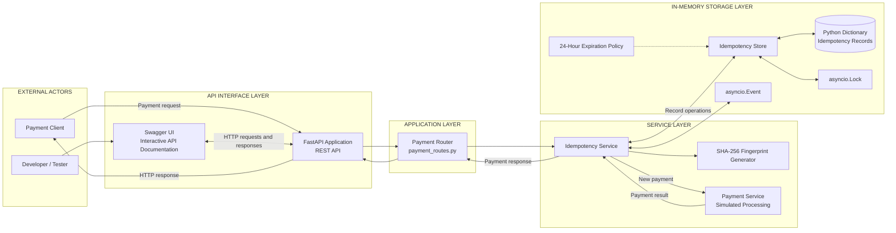
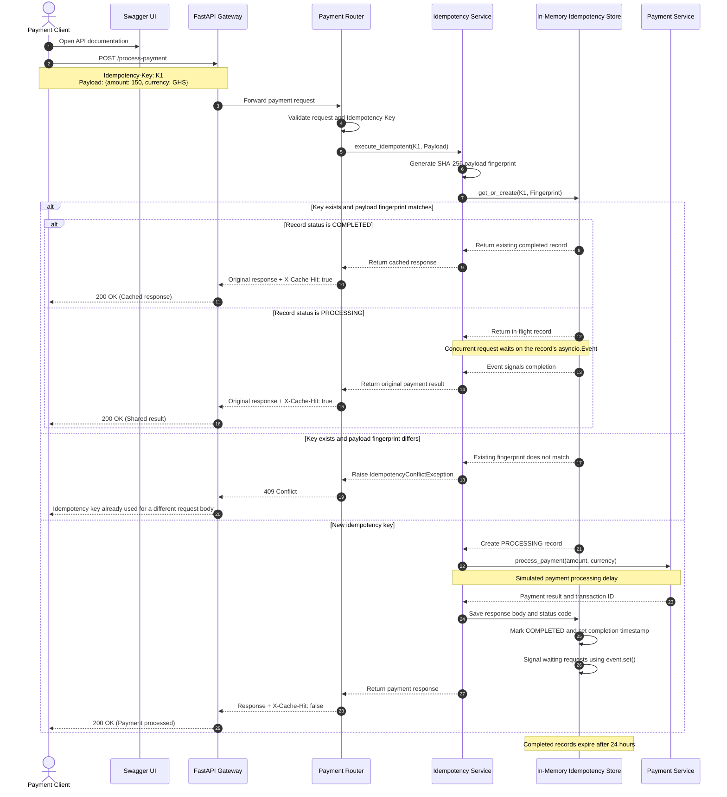
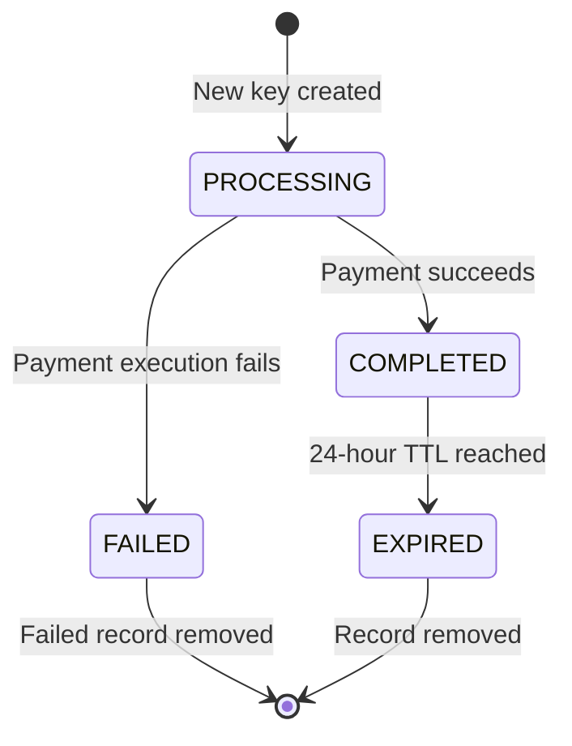

# FinSafe Idempotency Gateway
## The "Pay-Once" Protocol

**A concurrency-safe payment idempotency API built with FastAPI and Python.**

| Project Information | Details |
|---|---|
| Project | FinSafe Idempotency Gateway |
| Client | FinSafe Transactions Ltd. |
| Version | 1.0.0 |
| Language | Python 3.10 |
| Framework | FastAPI |
| Architecture | Modular, layered backend |
| Storage | In-memory Python dictionary |
| Concurrency | Python asyncio |
| Fingerprinting | SHA-256 |
| Deployment | Vercel |

**Live API:** https://finset-dfkmdtwri-divine8.vercel.app

**Interactive API Documentation:** [Open Swagger UI](https://finset-dfkmdtwri-divine8.vercel.app/docs)

---

# Table of Contents

1. [Project Overview](#1-project-overview)
2. [Software Architecture Document](#2-software-architecture-document-sad)
3. [System Components](#3-system-components)
4. [Detailed System Workflow](#4-detailed-system-workflow)
5. [Sequence Diagram](#5-sequence-diagram)
6. [Data Architecture and State Management](#6-data-architecture-and-state-management)
7. [API Documentation](#7-api-documentation)
8. [Design Decisions](#8-design-decisions)
9. [Developer's Choice: 24-Hour TTL](#9-developers-choice-24-hour-record-expiration)
10. [Technology Stack](#10-technology-stack)
11. [Project Structure](#11-project-structure)
12. [Installation and Setup](#12-installation-and-setup)
13. [Testing](#13-testing)
14. [Deployment](#14-deployment)
15. [Security and Reliability Considerations](#15-security-and-reliability-considerations)
16. [Limitations and Future Improvements](#16-limitations-and-future-improvements)
17. [Conclusion](#17-conclusion)

---

# 1. Project Overview

## 1.1 Business Problem

FinSafe Transactions Ltd. is a payment processor serving e-commerce businesses.

When customers make online payments, their requests may occasionally experience network timeouts. A payment request might reach the payment processor successfully, but the response may not reach the client.

The client may assume the transaction failed and automatically retry the request.

Without an idempotency mechanism, the payment processor may execute both requests, resulting in the customer being charged more than once.

This creates several business risks:

- Duplicate financial transactions.
- Customer dissatisfaction and loss of trust.
- Increased refund and dispute requests.
- Additional operational overhead.
- Potential regulatory and compliance concerns.

## 1.2 Proposed Solution

The FinSafe Idempotency Gateway introduces an idempotency layer that prevents repeated payment requests from independently executing the same payment operation.

The gateway uses a unique `Idempotency-Key` supplied in the HTTP request header to identify each payment operation.

Before processing a payment, the system checks whether the key has previously been used and compares the incoming request payload with the original payload.

Based on the result, the system can:

- Process a new payment.
- Return a previously stored payment response.
- Wait for an ongoing payment operation.
- Reject a request that reuses an existing key with a different payload.

The current implementation uses a simulated payment service and process-local in-memory storage.

## 1.3 Project Objectives

The primary objectives are:

1. Prevent duplicate payment execution.
2. Support safe retries after network failures.
3. Detect conflicting requests that reuse idempotency keys.
4. Handle simultaneous identical requests without race conditions.
5. Return the original payment response for matching duplicate requests.
6. Reduce unnecessary payment processing.
7. Automatically expire completed idempotency records after 24 hours.

---

# 2. Software Architecture Document (SAD)

## 2.1 Purpose

This section describes the software architecture of the FinSafe Idempotency Gateway, including its architectural style, layers, components, interactions, storage model, and design constraints.

It explains how the system is structured and how its components collaborate to enforce idempotency during payment processing.

## 2.2 Architectural Style

The system follows a **modular, layered backend architecture** implemented using FastAPI.

The architecture separates the API interface, request handling, business logic, payment execution, and storage responsibilities.

The system consists of four primary layers:

| Layer | Description |
|---|---|
| API Interface Layer | Exposes the REST API and interactive Swagger documentation. |
| Application Layer | Handles incoming HTTP requests and routes payment operations. |
| Service Layer | Implements idempotency logic, fingerprint generation, and payment execution. |
| Storage Layer | Maintains idempotency records and coordinates access to shared in-memory state. |

This separation allows individual components to be developed, tested, and maintained independently.

## 2.3 High-Level Architecture Flowchart

The following flowchart illustrates the structural organization of the system and the relationships between its components.



### Architecture Explanation

**API Interface Layer**

FastAPI exposes the payment endpoint, while Swagger UI provides interactive API documentation and testing.

**Application Layer**

The payment router receives validated requests, extracts the idempotency key, and delegates payment operations to the idempotency service.

**Service Layer**

The idempotency service coordinates request processing. The fingerprint generator identifies equivalent or conflicting payloads, while the payment service simulates payment execution.

**Storage Layer**

The in-memory store maintains idempotency records. An asynchronous lock coordinates access to the dictionary, and asynchronous events notify requests waiting for an ongoing payment operation.

The TTL mechanism manages the expiration of completed records.

## 2.4 Architectural Component Responsibilities

| Component | Responsibility |
|---|---|
| FastAPI Application | Initializes the backend, registers routes, and exposes API documentation. |
| Swagger UI | Provides interactive API testing and documentation. |
| Payment Router | Validates requests, extracts headers, and returns HTTP responses. |
| Idempotency Service | Coordinates duplicate detection, fingerprint comparison, and payment execution. |
| Fingerprint Generator | Generates deterministic SHA-256 payload fingerprints. |
| Payment Service | Simulates payment processing and generates transaction results. |
| In-Memory Store | Stores idempotency keys, fingerprints, processing states, and responses. |
| asyncio.Lock | Coordinates access to the shared in-memory dictionary. |
| asyncio.Event | Notifies waiting requests when the original payment operation finishes. |
| TTL Mechanism | Removes completed records after 24 hours. |

## 2.5 Architectural Boundaries

The gateway is responsible for coordinating payment requests and enforcing idempotency.

The payment service represents the execution boundary. In the current implementation, it simulates a payment operation rather than communicating with an external financial institution.

Swagger UI is a developer testing interface, not a separate customer-facing frontend.

The storage layer is process-local and does not provide persistent or distributed storage.

---

# 3. System Components

## 3.1 FastAPI Application

**File:** `app/main.py`

The FastAPI application is the main entry point of the backend.

Responsibilities:

- Initialize the FastAPI application.
- Configure application metadata.
- Register the payment router.
- Configure Swagger UI.
- Expose OpenAPI documentation.
- Manage application startup and shutdown.

The application exposes the following documentation routes:

| Endpoint | Purpose |
|---|---|
| `/docs` | Interactive Swagger UI |
| `/redoc` | ReDoc documentation |
| `/openapi.json` | OpenAPI specification |

## 3.2 Payment Router

**File:** `app/api/payment_routes.py`

The payment router exposes the payment-processing endpoint:

`POST /process-payment`

Responsibilities:

- Receive incoming payment requests.
- Extract the `Idempotency-Key` header.
- Validate request data.
- Invoke the idempotency service.
- Handle idempotency conflict exceptions.
- Return payment responses.
- Include the `X-Cache-Hit` response header.

The router separates HTTP communication from the underlying business logic.

## 3.3 Idempotency Service

**File:** `app/services/idempotency_service.py`

The idempotency service contains the core business logic of the gateway.

Responsibilities:

- Generate request fingerprints.
- Retrieve or create idempotency records.
- Compare incoming and stored fingerprints.
- Identify completed duplicate requests.
- Identify in-flight requests.
- Wait for ongoing payment execution.
- Execute new payment operations.
- Store completed payment responses.
- Notify waiting requests.
- Handle failed processing attempts.

It ensures that matching requests using the same key do not independently execute payment processing within the same running application process.

## 3.4 Fingerprint Generator

The fingerprint generator uses SHA-256 to identify payment payloads.

Before hashing, the request payload is normalized into a deterministic JSON representation.

The normalization process includes:

- Sorting JSON object keys.
- Using compact JSON separators.
- Normalizing decimal values.
- Rejecting unsupported non-finite numeric values.

For example, these payloads are considered equivalent:

```json
{
  "amount": 100,
  "currency": "RWF"
}
```

```json
{
  "currency": "RWF",
  "amount": 100.00
}
```

Their normalized representations produce matching fingerprints.

This allows the system to compare payment requests based on their actual payload values rather than their original JSON formatting.

## 3.5 Payment Service

**File:** `app/services/payment_service.py`

The payment service represents the payment execution component.

Responsibilities:

- Receive payment information.
- Simulate payment processing.
- Generate a transaction identifier.
- Construct the payment response.
- Return the payment result to the idempotency service.

The current implementation simulates payment processing with an approximately two-second delay.

It does not communicate with a real banking institution or external payment processor.

## 3.6 In-Memory Idempotency Store

**File:** `app/storage/idempotency_store.py`

The storage component maintains idempotency records using a Python dictionary.

Each record contains:

| Attribute | Description |
|---|---|
| `key` | Unique idempotency key supplied by the client. |
| `fingerprint` | SHA-256 fingerprint of the original request. |
| `status` | Current processing state. |
| `response_body` | Stored payment response. |
| `status_code` | Original HTTP status code. |
| `event` | Asynchronous event for waiting requests. |
| `created_at` | Record creation timestamp. |
| `completed_at` | Payment completion timestamp. |

The store provides operations for retrieving, creating, completing, failing, counting, clearing, and cleaning up records.

## 3.7 Exception Handling

**File:** `app/core/exceptions.py`

The application defines an idempotency conflict exception for requests that reuse an existing key with a different payload.

The router handles this exception and returns an HTTP 409 Conflict response.

Unexpected processing errors are propagated through the application's error-handling mechanism.

---

# 4. Detailed System Workflow

## 4.1 First Payment Request

When a client submits a payment request with a new idempotency key:

1. FastAPI receives the HTTP request.
2. The payment router validates the request and header.
3. The idempotency service generates a SHA-256 fingerprint.
4. The store checks whether the key already exists.
5. A new idempotency record is created.
6. The record is assigned the `PROCESSING` state.
7. The payment service executes the simulated payment.
8. The payment result is returned.
9. The response body and status code are stored.
10. The record transitions to `COMPLETED`.
11. The completion timestamp is recorded.
12. The event is signalled to notify waiting requests.
13. The original response is returned to the client.

Response header:

```http
X-Cache-Hit: false
```

## 4.2 Duplicate Request

When the client retries the request using the same key and payload:

1. The gateway receives the request.
2. The idempotency service generates the request fingerprint.
3. The store retrieves the existing record.
4. The incoming fingerprint is compared with the stored fingerprint.
5. The fingerprints match.
6. The record is already completed.
7. The original response body and status code are returned.

The payment service is not executed again.

Response header:

```http
X-Cache-Hit: true
```

## 4.3 Conflicting Request

When the same key is reused with a different payload:

1. The existing record is retrieved.
2. A fingerprint is generated for the new payload.
3. The fingerprints are compared.
4. They do not match.
5. An idempotency conflict exception is raised.
6. The router returns HTTP 409 Conflict.

The payment service is not executed for the conflicting request.

## 4.4 Concurrent Request Handling

The gateway uses `asyncio.Event` to coordinate matching requests that arrive while an original payment is still processing.

For example:

- Request A arrives and creates a new record.
- Request A starts payment processing.
- Request B arrives using the same key and payload.
- Request B retrieves the existing `PROCESSING` record.
- Request B waits on the record's asynchronous event.
- Request A finishes payment processing.
- The payment result is saved.
- Request A signals the event.
- Request B wakes up and retrieves the original payment result.

This prevents matching concurrent requests from independently executing the payment service within the same process.

## 4.5 Failed Payment Processing

If payment processing raises an exception:

1. The idempotency service handles the failure.
2. The record is marked as failed.
3. Waiting requests are notified.
4. The failed record is removed.
5. The exception is propagated.

A subsequent request can retry using the same key.

---

# 5. Sequence Diagram

The sequence diagram illustrates the interaction between the client, API interface, router, idempotency service, in-memory store, and payment service.



---

# 6. Data Architecture and State Management

## 6.1 Storage Model

The current implementation uses a process-local Python dictionary.

The dictionary stores idempotency records indexed by their unique keys.

Conceptual structure:

```text
Idempotency Store
│
├── payment-key-001
│   ├── fingerprint
│   ├── status
│   ├── response_body
│   ├── status_code
│   ├── event
│   ├── created_at
│   └── completed_at
│
├── payment-key-002
│   ├── fingerprint
│   ├── status
│   ├── response_body
│   ├── status_code
│   ├── event
│   ├── created_at
│   └── completed_at
│
└── payment-key-003
    └── ...
```

## 6.2 Record Lifecycle



| State | Description |
|---|---|
| PROCESSING | Payment operation is being executed. |
| COMPLETED | Payment succeeded and the response was stored. |
| FAILED | Payment execution raised an exception and the record was removed. |
| EXPIRED | A completed record reached its expiration time and can be removed. |

## 6.3 Concurrency Management

The implementation uses two asynchronous synchronization mechanisms.

**asyncio.Lock**

Coordinates access to the shared in-memory dictionary and protects record operations from conflicting concurrent access.

**asyncio.Event**

Notifies waiting requests when the original payment operation completes or fails.

The event allows concurrent matching requests to wait without starting another payment execution.

## 6.4 Record Expiration

Completed records have a configured 24-hour time-to-live.

The expiration period is measured from `completed_at`, not `created_at`.

The expiration mechanism:

- Applies only to completed records.
- Does not remove active processing records.
- Removes expired records when their keys are accessed.
- Supports explicit cleanup through `cleanup_expired()`.

After an expired record is removed, its key can be treated as a new request.

---

# 7. API Documentation

## 7.1 Base URL

**Production:**

```text
https://finset-dfkmdtwri-divine8.vercel.app
```

**Swagger UI:**

https://finset-dfkmdtwri-divine8.vercel.app/docs

**Local Development:**

```text
http://127.0.0.1:8000
```

## 7.2 Payment Endpoint

| Property | Value |
|---|---|
| Method | POST |
| Endpoint | `/process-payment` |
| Content-Type | `application/json` |
| Required Header | `Idempotency-Key` |
| Success Status | 200 OK |

### Request Headers

```http
POST /process-payment
Content-Type: application/json
Idempotency-Key: payment-123
```

### Request Body

```json
{
  "amount": 150,
  "currency": "GHS"
}
```

### Successful Response

```json
{
  "transaction_id": "generated-transaction-id",
  "amount": 150,
  "currency": "GHS",
  "status": "SUCCESS",
  "message": "Charged 150 GHS"
}
```

Response header:

```http
X-Cache-Hit: false
```

## 7.3 Duplicate Request

Submit the same request again using:

```http
Idempotency-Key: payment-123
```

Request body:

```json
{
  "amount": 150,
  "currency": "GHS"
}
```

The gateway returns the original response, including the original transaction ID.

Response header:

```http
X-Cache-Hit: true
```

The payment service does not execute again.

## 7.4 Conflicting Request

Reuse the same key but change the payment amount:

```http
Idempotency-Key: payment-123
```

```json
{
  "amount": 500,
  "currency": "GHS"
}
```

Expected response:

**HTTP 409 Conflict**

```json
{
  "detail": "Idempotency key already used for a different request body."
}
```

## 7.5 HTTP Status Codes

| Status | Description |
|---|---|
| 200 | Payment successfully processed or original response replayed. |
| 400 | Missing or empty idempotency key. |
| 409 | Existing key reused with a different request payload. |
| 422 | Request validation failed. |
| 500 | Unexpected internal processing error. |

---

# 8. Design Decisions

## 8.1 FastAPI

FastAPI was selected because it supports asynchronous request handling and provides automatic request validation through Pydantic.

It also generates OpenAPI documentation and Swagger UI automatically.

## 8.2 In-Memory Storage

A Python dictionary was selected to store idempotency records.

The assignment permits an in-memory store, and this implementation keeps the architecture lightweight while demonstrating the core idempotency mechanism.

The trade-off is that records are not persistent and are not shared across separate application processes.

## 8.3 SHA-256 Fingerprinting

SHA-256 provides deterministic fingerprints for comparing payment payloads.

Canonical JSON serialization ensures equivalent payloads produce equivalent fingerprints.

## 8.4 asyncio.Lock

An asynchronous lock coordinates operations on the shared dictionary.

It is suitable for the current single-process asynchronous architecture but does not provide distributed synchronization.

## 8.5 asyncio.Event

An asynchronous event allows matching in-flight requests to wait for the original payment result.

This avoids executing the payment service multiple times for simultaneous matching requests.

## 8.6 Modular Structure

The project separates:

- API routing.
- Request schemas.
- Business logic.
- Payment execution.
- Storage.
- Exception handling.

This separation improves readability, maintainability, and testability.

---

# 9. Developer's Choice: 24-Hour Record Expiration

## 9.1 Feature Description

The additional safety mechanism implemented in this project is a **24-hour Time-To-Live (TTL) expiration policy** for completed idempotency records.

## 9.2 Problem Addressed

Without an expiration mechanism, completed idempotency records could remain in memory indefinitely.

As the number of payment requests increases, this could lead to unnecessary memory consumption.

## 9.3 Implementation

The system records the completion timestamp when a payment successfully finishes.

The completed record remains available for 24 hours after that timestamp.

After the expiration period:

1. The record is identified as expired.
2. It becomes eligible for removal.
3. It is removed when accessed or through explicit cleanup.
4. Its key can subsequently be treated as a new request.

The expiration mechanism does not remove records that are still processing.

## 9.4 Why It Was Added

The TTL feature provides a defined retention period for completed idempotency records.

It helps control memory consumption and ensures that records are not retained indefinitely in the in-memory store.

It is a record-management feature, not a replacement for persistent storage or distributed coordination.

---

# 10. Technology Stack

| Technology | Purpose |
|---|---|
| Python 3.10 | Main programming language |
| FastAPI | REST API framework |
| Pydantic v2 | Request and response validation |
| asyncio | Asynchronous execution and synchronization |
| SHA-256 | Request fingerprint generation |
| Python Dictionary | In-memory idempotency storage |
| pytest | Automated testing |
| pytest-asyncio | Asynchronous testing |
| HTTPX | API testing |
| Uvicorn | ASGI application server |
| Swagger UI / OpenAPI | API documentation |
| Vercel | Deployment platform |

---

# 11. Project Structure

```text
Idempotency-gateway/
│
├── app/
│   ├── api/
│   │   ├── __init__.py
│   │   └── payment_routes.py
│   │
│   ├── core/
│   │   ├── __init__.py
│   │   └── exceptions.py
│   │
│   ├── schemas/
│   │   ├── __init__.py
│   │   └── payment.py
│   │
│   ├── services/
│   │   ├── __init__.py
│   │   ├── idempotency_service.py
│   │   └── payment_service.py
│   │
│   ├── storage/
│   │   └── idempotency_store.py
│   │
│   └── main.py
│
├── tests/
│   ├── __init__.py
│   ├── test_concurrancy.py
│   ├── test_idempotency.py
│   ├── test_idempotency_expiration.py
│   └── test_payment.py
│
├── .gitignore
├── .python-version
├── requirements.txt
└── README.md
```

---

# 12. Installation and Setup

## 12.1 Prerequisites

Install the following:

- Python 3.10 or later.
- pip.
- Git.

## 12.2 Fork and Clone

Fork the original repository to your GitHub account.

Clone your fork:

```bash
git clone <your-forked-repository-url>
```

Navigate into the project:

```bash
cd Idempotency-gateway
```

## 12.3 Create a Virtual Environment

```bash
python3.10 -m venv venv
```

Activate it on Linux or macOS:

```bash
source venv/bin/activate
```

On Windows:

```bash
venv\Scripts\activate
```

## 12.4 Install Dependencies

```bash
pip install -r requirements.txt
```

## 12.5 Run the Application

```bash
python3.10 -m uvicorn app.main:app --reload
```

The API will be available at:

```text
http://127.0.0.1:8000
```

Open the interactive API documentation:

```text
http://127.0.0.1:8000/docs
```

---

# 13. Testing

## 13.1 Testing Tools

The project uses:

- **pytest:** Automated test execution.
- **pytest-asyncio:** Testing asynchronous application behavior.
- **HTTPX:** HTTP API testing.

## 13.2 Test Coverage

| Test Scenario | Expected Result |
|---|---|
| First payment request | Payment is processed successfully. |
| Duplicate request | Original response is returned. |
| Same key, different payload | HTTP 409 Conflict. |
| Concurrent identical requests | One payment execution within the process. |
| Different idempotency keys | Independent payment operations. |
| Missing key | HTTP 400. |
| Empty key | HTTP 400. |
| Invalid amount | Validation error. |
| Invalid currency | Validation error. |
| Currency normalization | Currency is converted to uppercase. |
| Different JSON key ordering | Equivalent payloads produce matching fingerprints. |
| Equivalent decimal values | Matching fingerprints. |
| Completed record expiration | Expired record can be removed. |
| Active processing record cleanup | Processing record is preserved. |

## 13.3 Run the Test Suite

Execute:

```bash
python3.10 -m pytest -v
```

### Latest Reported Test Result

```text
14 passed in 16.36s
```

This is the last reported test result from development.

---

# 14. Deployment

## 14.1 Deployment Platform

The application is deployed on Vercel.

**Production Base URL:**

https://finset-dfkmdtwri-divine8.vercel.app

**API Documentation:**

https://finset-dfkmdtwri-divine8.vercel.app/docs

## 14.2 Deployment Considerations

The current implementation uses an in-memory Python dictionary.

Consequently:

- Records are lost when the application process restarts.
- Separate serverless instances do not share idempotency records.
- Requests routed to different instances may not coordinate.
- The 24-hour TTL does not guarantee that records survive deployments or restarts.

The deployed implementation demonstrates process-local idempotency, not globally consistent idempotency across distributed production instances.

---

# 15. Security and Reliability Considerations

The implementation includes several mechanisms that contribute to request integrity and reliability.

## 15.1 Request Validation

Pydantic validates incoming payment request data before business logic executes.

## 15.2 Idempotency-Key Validation

The API requires a non-empty idempotency key to identify a payment operation.

## 15.3 Payload Integrity

SHA-256 fingerprint comparison detects requests that reuse an existing key with different payment data.

## 15.4 Concurrent Access Protection

`asyncio.Lock` coordinates access to the in-memory store, while `asyncio.Event` allows matching requests to wait for an ongoing payment operation.

## 15.5 Failure Handling

Failed records are removed after the failure is handled, allowing subsequent requests to retry.

## 15.6 Current Limitations

The current implementation does not provide:

- Client authentication.
- Authorization.
- Persistent transaction audit logs.
- Distributed locking.
- Durable recovery after process failure.
- Real payment provider reconciliation.

SHA-256 is used for request fingerprinting, not authentication or authorization.

---

# 16. Limitations and Future Improvements

The current implementation demonstrates the required idempotency behavior within a single running application process.

The following improvements would be necessary for a production payment environment.

## 16.1 Persistent Storage

Introduce a durable database to retain idempotency records across process restarts and deployments.

## 16.2 Distributed Coordination

Introduce shared storage and distributed coordination so multiple application instances can access and manage the same idempotency records.

## 16.3 Real Payment Provider Integration

Replace the simulated payment service with an integration to an actual payment processor.

The integration must account for uncertain external outcomes, such as a provider successfully processing a payment while the gateway fails to receive its response.

## 16.4 Crash Recovery

Introduce durable transaction states and recovery procedures for payment operations interrupted by process failures.

## 16.5 Authentication and Authorization

Secure payment endpoints and ensure only authorized clients can initiate payment operations.

## 16.6 Observability

Introduce structured logging, metrics, and tracing to monitor payment requests, duplicate attempts, conflicts, and processing failures.

These improvements are future architectural considerations and are not part of the current implementation.

---

# 17. Conclusion

The FinSafe Idempotency Gateway demonstrates how idempotency keys, deterministic request fingerprinting, asynchronous synchronization, and controlled record management can prevent duplicate payment execution.

Its modular architecture separates HTTP request handling, idempotency coordination, payment execution, and storage responsibilities.

The system supports new payment processing, duplicate response replay, conflicting request detection, and concurrent in-flight request coordination.

The additional 24-hour expiration feature provides a defined retention period for completed idempotency records and helps control memory consumption.

The current implementation demonstrates process-local idempotency using an in-memory store. Persistent storage and distributed coordination remain important architectural requirements for reliable idempotency across multiple production instances.

---

**FINSAFE IDEMPOTENCY GATEWAY**

*The Pay-Once Protocol*

