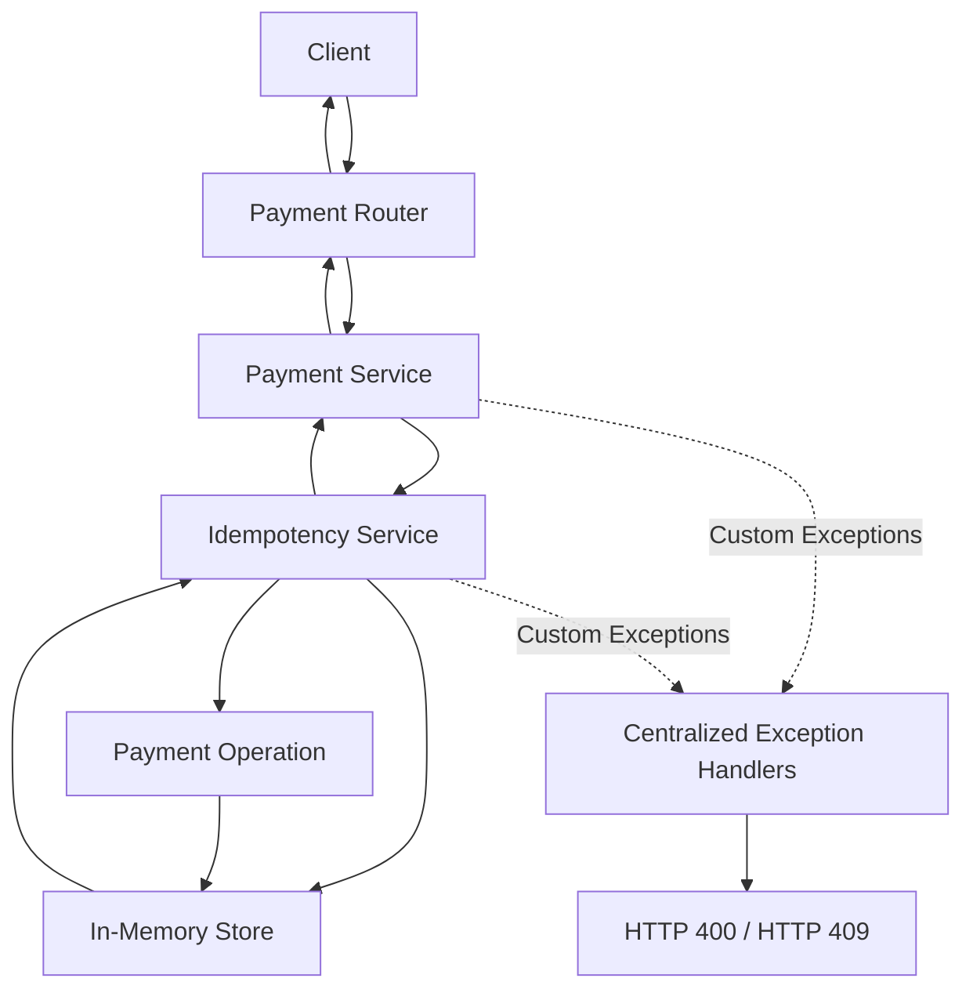
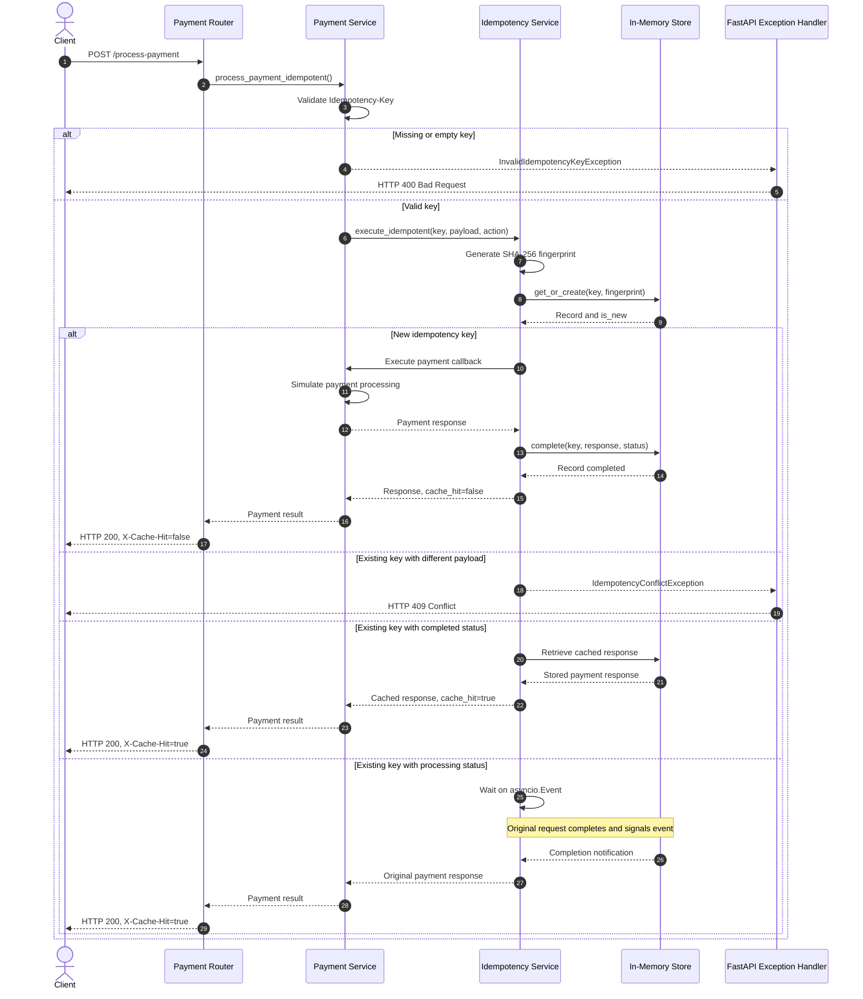
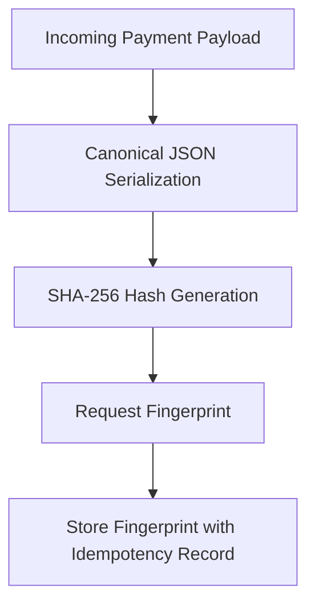
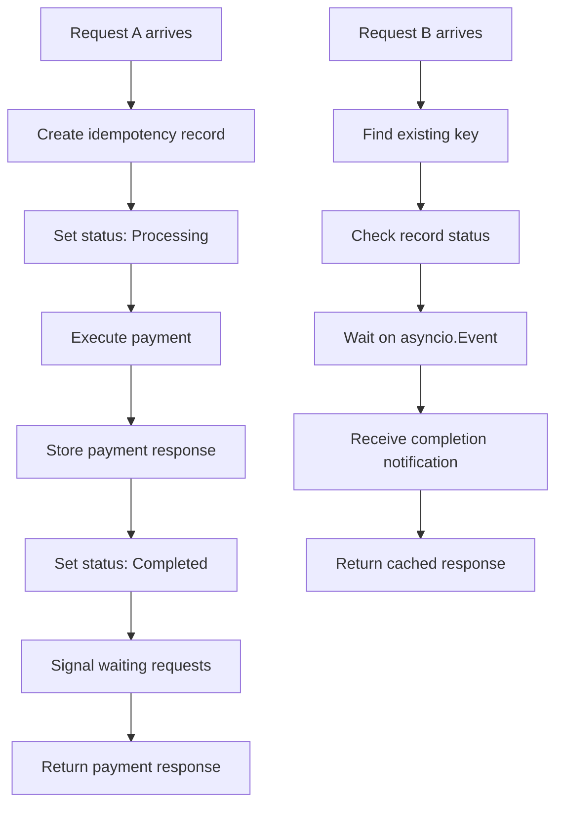
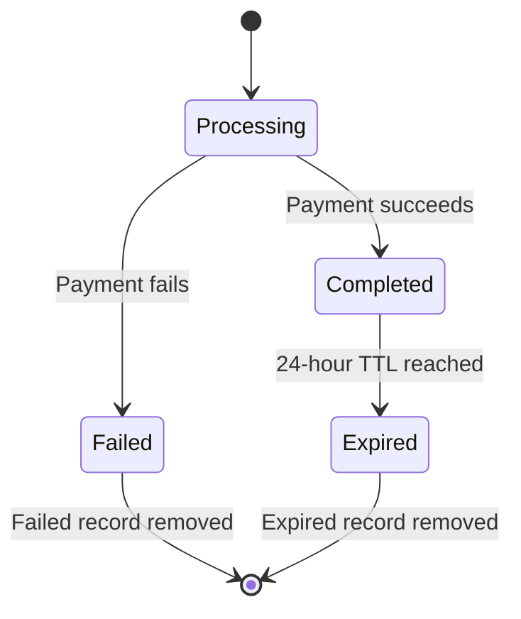

# FinSafe Idempotency Gateway
### The "Pay-Once" Protocol

A concurrency-safe payment idempotency gateway built with **Python and FastAPI**.

FinSafe prevents duplicate payment execution when clients retry requests or submit multiple requests concurrently. It uses unique idempotency keys, SHA-256 request fingerprints, asynchronous concurrency control, and cached responses to ensure that matching requests reuse the original payment result.

---

## 1. Project Overview

Payment systems must handle situations where a client submits a payment request but does not receive a response because of a network interruption, timeout, or temporary service failure.

The client may retry the request without knowing whether the original payment was processed.

Without idempotency protection, the same payment could be executed more than once.

FinSafe introduces an idempotency layer between the client and payment processing logic. It identifies repeated requests and ensures that a matching request does not execute the payment operation again.

The current implementation simulates payment processing and demonstrates how an idempotency mechanism can be implemented in an asynchronous API.

## 2. Problem Statement

Payment APIs are vulnerable to duplicate requests caused by:

- Network interruptions and timeouts.
- Automatic client retries.
- Users submitting payment forms multiple times.
- Multiple requests arriving simultaneously.
- Uncertain responses after payment execution.

For example:

A client submits a payment of 250 GHS using the idempotency key `payment_001`.

The payment is processed successfully, but the client does not receive the response because of a network interruption.

The client retries the same request using `payment_001`.

Without idempotency protection, the payment could be processed again.

FinSafe addresses this problem by associating each idempotency key with a fingerprint of the original request and storing the result of successful processing.

## 3. Project Objectives

The project aims to:

1. Prevent duplicate payment execution.
2. Support safe retries using idempotency keys.
3. Handle concurrent requests using the same key.
4. Detect when an idempotency key is reused with a different request payload.
5. Store and replay completed payment responses.
6. Implement a 24-hour expiration period for completed records.
7. Separate routing, business logic, exception handling, and storage responsibilities.
8. Provide clear HTTP responses for invalid and conflicting requests.
9. Demonstrate asynchronous request coordination using Python's `asyncio`.

## 4. Technology Stack

| Technology | Purpose |
|---|---|
| Python 3.10 | Backend programming language |
| FastAPI | REST API framework |
| Pydantic v2 | Request validation and response schemas |
| asyncio | Asynchronous execution and concurrency coordination |
| SHA-256 | Request fingerprint generation |
| In-memory dictionary | Idempotency record storage |
| asyncio.Lock | Atomic coordination of storage operations |
| asyncio.Event | Notification of waiting concurrent requests |
| pytest | Automated testing |
| pytest-asyncio | Asynchronous testing |
| HTTPX | API endpoint testing |
| Uvicorn | ASGI application server |
| Vercel | Deployment platform |

## 5. System Architecture

FinSafe follows a layered architecture to separate HTTP communication, business logic, exception handling, and data storage.

### 5.1 Architecture Layers

**1. API Layer — `app/api/`**

The API layer exposes the payment endpoint and handles incoming HTTP requests.

Responsibilities:
- Receive payment requests.
- Extract the `Idempotency-Key` header.
- Pass request data to the Payment Service.
- Set response headers and HTTP status codes.
- Return the payment result to the client.

The router remains thin and delegates business operations to the service layer.

**2. Service Layer — `app/services/`**

The service layer contains the application's business logic.

`payment_service.py`

Responsible for:
- Validating the idempotency key.
- Preparing the payment payload.
- Defining and executing the simulated payment operation.
- Delegating idempotency processing.
- Formatting the cache-hit response header.

`idempotency_service.py`

Responsible for:
- Generating SHA-256 request fingerprints.
- Retrieving or creating idempotency records.
- Comparing incoming and stored fingerprints.
- Detecting conflicting requests.
- Returning cached responses.
- Coordinating concurrent requests.
- Managing payment execution outcomes.

**3. Core Layer — `app/core/`**

The core layer contains application-level exceptions and centralized exception handling.

`exceptions.py`

Defines custom exceptions:
- `InvalidIdempotencyKeyException`
- `IdempotencyConflictException`

`exception_handlers.py`

Converts application exceptions into HTTP responses:
- Invalid idempotency keys return HTTP 400.
- Reused keys with different payloads return HTTP 409.

**4. Storage Layer — `app/storage/`**

The storage layer manages idempotency records using an in-memory dictionary.

`idempotency_store.py`

Responsible for:
- Creating and retrieving records.
- Maintaining record states.
- Coordinating access with `asyncio.Lock`.
- Storing completed payment responses.
- Signaling waiting requests with `asyncio.Event`.
- Removing failed records.
- Managing completed-record expiration.

**5. Application Entry Point — `app/main.py`**

The application entry point:
- Creates the FastAPI application.
- Configures API metadata.
- Registers centralized exception handlers.
- Includes the payment router.
- Manages application startup and shutdown.

### 5.2 High-Level Component Architecture



### 5.3 System Diagram

The sequence diagram illustrates the communication between the client, router, services, storage layer, and exception handler.

It covers the main request scenarios:
- A new payment request.
- A repeated request with the same payload.
- A conflicting request with a different payload.
- Concurrent requests using the same idempotency key.



The concurrent-request scenario illustrates successful completion. If the original payment operation fails, waiting requests are notified but do not receive a successful cached response.

## 6. Idempotency Mechanism

The idempotency mechanism is the central component of FinSafe.

It ensures that repeated requests with the same key and equivalent payload reuse the original result.

### 6.1 Idempotency Key

The client provides an idempotency key through the HTTP header:

```http
Idempotency-Key: payment_001
```

The key identifies a logical payment operation.

The same key must be reused when retrying the same payment request.

### 6.2 Request Fingerprinting

FinSafe uses SHA-256 to generate a fingerprint of the request payload.

Before generating the hash, the payload is serialized into canonical JSON.

The serialization uses:

- Sorted object keys.
- Compact JSON separators.
- Consistent Unicode handling.
- Rejection of non-standard JSON numeric values.

This ensures that equivalent JSON objects produce the same fingerprint even if their key order differs.

### Fingerprinting Process



When another request uses the same key, its fingerprint is compared with the stored fingerprint.

| Condition | Result |
|---|---|
| Same key + same fingerprint | Return or wait for the original result. |
| Same key + different fingerprint | Return HTTP 409 Conflict. |
| New key | Create a new idempotency record and process payment. |

### 6.3 Why Fingerprinting Is Necessary

An idempotency key alone is not sufficient.

For example, consider these requests:

First request:

```json
{
  "amount": 250,
  "currency": "GHS"
}
```

Second request:

```json
{
  "amount": 500,
  "currency": "GHS"
}
```

Both requests use the same idempotency key.

The payloads are different, so their fingerprints will differ.

FinSafe rejects the second request rather than returning the first payment's result or processing a different payment under the same key.

## 7. Concurrency Management

FinSafe uses Python's asynchronous programming capabilities to coordinate simultaneous requests.

Two important mechanisms are used.

### 7.1 asyncio.Lock

The storage layer uses `asyncio.Lock` to coordinate access to the shared in-memory dictionary.

This protects critical storage operations such as:
- Retrieving records.
- Creating new records.
- Updating record states.
- Removing records.
- Cleaning up expired records.

It ensures that operations on the shared store are coordinated within the application process.

### 7.2 asyncio.Event

The system uses `asyncio.Event` to coordinate requests that arrive while an existing payment is still processing.

For example:

- Request A arrives with a new key.
- Request A creates a record with status `processing`.
- Request B arrives using the same key and payload.
- Request B finds the existing processing record.
- Request B waits on the record's event.
- Request A completes payment processing.
- The storage layer updates the record and signals the event.
- Request B wakes up and retrieves the completed response.

This prevents Request B from executing the same payment operation again.

### 7.3 Concurrent Request Handling



This coordination is process-local. It does not provide distributed locking across separate application instances.

## 8. Idempotency Record Management

Each idempotency record stores the information needed to identify a request and reproduce its completed response.

The record includes:

| Field | Description |
|---|---|
| `key` | Unique idempotency key supplied by the client. |
| `fingerprint` | SHA-256 hash of the request payload. |
| `status` | Current processing state. |
| `response_body` | Stored payment response. |
| `status_code` | HTTP status code associated with the stored response. |
| `event` | Asynchronous event used to notify waiting requests. |
| `created_at` | Time when the record was created. |
| `completed_at` | Time when payment processing completed. |

### 8.1 Record States

The record uses three states:

| State | Description |
|---|---|
| `processing` | The payment operation is currently executing. |
| `completed` | The payment operation succeeded and its response was stored. |
| `failed` | The payment operation failed before the record was removed. |

### 8.2 Record Lifecycle



Processing records are not removed by TTL cleanup.

Failed records are removed so that a subsequent request can retry using the same key.

## 9. Response Caching and Replay

When a payment is successfully processed, the response body and status code are stored in the idempotency record.

For subsequent requests using the same key and payload, the system returns the stored response.

This means:
- The payment operation is not executed again.
- The original transaction ID is preserved.
- The original response body is returned.
- The response is identified as a cache hit.

FinSafe exposes this behavior through the `X-Cache-Hit` response header.

| Header Value | Meaning |
|---|---|
| `false` | A new payment operation was executed. |
| `true` | A previously completed response was returned. |

Example:

First request:

```http
X-Cache-Hit: false
```

Repeated request:

```http
X-Cache-Hit: true
```

## 10. Idempotency Key Expiration

FinSafe implements a 24-hour time-to-live (TTL) for completed idempotency records.

The TTL is configured as:

```python
ttl_seconds = 86400
```

The expiration period starts when the payment operation completes.

### Expiration Rules

- Completed records expire after 86,400 seconds.
- Processing records are not expired by TTL cleanup.
- Failed records are removed to allow retries.
- Expired records can be replaced when the same key is submitted again.
- Expiration is checked when a key is accessed or when `cleanup_expired()` is explicitly called.

The current implementation does not use a background cleanup scheduler.

This means expiration cleanup is lazy rather than continuously scheduled.

## 11. Exception Handling

FinSafe uses custom application exceptions and centralized FastAPI exception handlers.

This separates business-level error detection from HTTP response construction.

### 11.1 Custom Exceptions

`InvalidIdempotencyKeyException`

Raised when the `Idempotency-Key` header is missing or contains only whitespace.

Expected HTTP response:

`400 Bad Request`

`IdempotencyConflictException`

Raised when an existing idempotency key is reused with a different request payload.

Expected HTTP response:

`409 Conflict`

### 11.2 Centralized Exception Handling

The exception handlers are defined in:

`app/core/exception_handlers.py`

They are registered in:

`app/main.py`

The service layer raises the relevant application exception, and FastAPI dispatches it to the registered handler.

This avoids repeating HTTP exception translation in individual routes.

### 11.3 Exception Handling Responsibilities

| Component | Responsibility |
|---|---|
| `exceptions.py` | Defines custom application exceptions. |
| `exception_handlers.py` | Converts custom exceptions into HTTP responses. |
| `main.py` | Registers the handlers with FastAPI. |
| Service layer | Raises exceptions when business rules are violated. |

## 12. API Documentation

### Base URL

Local development:

`http://127.0.0.1:8000`

Deployed application:

`https://finset-dfkmdtwri-divine8.vercel.app`

### Interactive Documentation

Swagger UI:

https://finset-dfkmdtwri-divine8.vercel.app/docs

ReDoc:

https://finset-dfkmdtwri-divine8.vercel.app/redoc

### Endpoint

**Process Payment**

```http
POST /process-payment
```

### Request Headers

| Header | Required | Description |
|---|---|---|
| `Idempotency-Key` | Yes | Unique identifier for the payment request. |
| `Content-Type` | Yes | Specifies JSON request content. |

Example:

```http
Idempotency-Key: payment_001
Content-Type: application/json
```

### Request Body

```json
{
  "amount": 250,
  "currency": "GHS"
}
```

### Successful Response

HTTP Status: `200 OK`

```json
{
  "message": "Charged 250 GHS",
  "amount": 250.0,
  "currency": "GHS",
  "transaction_id": "tx_a1b2c3d4e5",
  "status": "SUCCESS"
}
```

The transaction ID is generated dynamically for each newly processed payment.

### Error Responses

**Missing or invalid idempotency key**

HTTP Status: `400 Bad Request`

```json
{
  "detail": "Header 'Idempotency-Key' is missing or invalid."
}
```

**Idempotency conflict**

HTTP Status: `409 Conflict`

```json
{
  "detail": "Idempotency key already used for a different request body."
}
```

**Invalid request body**

HTTP Status: `422 Unprocessable Entity`

FastAPI and Pydantic return validation details when the request body does not satisfy the payment schema.

### HTTP Status Codes

| Status Code | Description |
|---|---|
| 200 | Payment successfully processed or cached response returned. |
| 400 | Missing or invalid idempotency key. |
| 409 | Idempotency key reused with a different payload. |
| 422 | Request validation failed. |
| 500 | Unexpected server-side error. |

## 13. Project Structure

```text
Idempotency-gateway/
│
├── app/
│   │
│   ├── api/
│   │   ├── __init__.py
│   │   └── payment_routes.py
│   │
│   ├── core/
│   │   ├── __init__.py
│   │   ├── exceptions.py
│   │   └── exception_handlers.py
│   │
│   ├── schemas/
│   │   ├── __init__.py
│   │   └── payment.py
│   │
│   ├── services/
│   │   ├── __init__.py
│   │   ├── idempotency_service.py
│   │   └── payment_service.py
│   │
│   ├── storage/
│   │   └── idempotency_store.py
│   │
│   └── main.py
│
├── tests/
│   ├── __init__.py
│   ├── test_concurrancy.py
│   ├── test_idempotency.py
│   ├── test_idempotency_expiration.py
│   └── test_payment.py
│
├── .gitignore
├── .python-version
├── requirements.txt
└── README.md
```

## 14. Installation and Setup

### Prerequisites

- Python 3.10 or later.
- pip.
- Git.

### Clone the Repository

```bash
git clone https://github.com/iirasubizadivine/finsafe-idempotency-gateway.git
```

Navigate into the project directory:

```bash
cd Idempotency-gateway
```

### Create a Virtual Environment

```bash
python3.10 -m venv venv
```

Activate the environment on Linux or macOS:

```bash
source venv/bin/activate
```

### Install Dependencies

```bash
pip install -r requirements.txt
```

## 15. Running the Application

Start the FastAPI development server:

```bash
python3.10 -m uvicorn app.main:app --reload
```

The application will be available at:

`http://127.0.0.1:8000`

Open the interactive API documentation:

`http://127.0.0.1:8000/docs`

## 16. Testing

FinSafe uses pytest, pytest-asyncio, and HTTPX for automated testing.

Run the complete test suite:

```bash
python3.10 -m pytest -v
```

### Test Coverage

| Test File | Purpose |
|---|---|
| `test_payment.py` | Payment processing, missing headers, invalid amounts, and currency validation. |
| `test_idempotency.py` | Duplicate requests, cached responses, conflicting payloads, and different keys. |
| `test_concurrancy.py` | Concurrent request handling and duplicate execution prevention. |
| `test_idempotency_expiration.py` | Completed-record expiration and processing-record cleanup behavior. |

### Important Test Scenarios

The test suite covers:

1. Successful payment processing.
2. Repeated requests returning the cached response.
3. Reusing a key with a different payload.
4. Requests with different JSON object key ordering.
5. Separate payment operations using different keys.
6. Missing idempotency keys.
7. Empty or whitespace-only idempotency keys.
8. Invalid payment amounts.
9. Invalid currency formats.
10. Currency normalization.
11. Concurrent requests using the same idempotency key.
12. Expiration of completed records.
13. Protection of processing records from TTL cleanup.

## 17. Deployment

FinSafe is deployed using Vercel.

**Production URL**

https://finset-dfkmdtwri-divine8.vercel.app

**Swagger Documentation**

https://finset-dfkmdtwri-divine8.vercel.app/docs

### Deployment Considerations

The current implementation uses a process-local in-memory dictionary.

This has important implications:

- Records are stored in application memory.
- Records are lost when the application process restarts.
- Separate serverless instances do not share the same records.
- Separate workers do not share the same in-memory state.
- The implementation does not provide distributed idempotency guarantees.

For a production system operating across multiple instances, a shared storage solution such as Redis or a transactional database would be required.

## 18. Design Decisions and Trade-offs

| Design Decision | Reason |
|---|---|
| SHA-256 fingerprinting | Identifies equivalent request payloads. |
| Canonical JSON serialization | Prevents JSON key ordering from changing the fingerprint. |
| `asyncio.Lock` | Coordinates access to shared in-memory storage. |
| `asyncio.Event` | Allows matching concurrent requests to wait for payment completion. |
| 24-hour TTL | Defines the retention period for completed idempotency records. |
| Centralized exception handlers | Separates HTTP error responses from business logic. |
| In-memory storage | Keeps the implementation simple without external infrastructure. |

### Current Limitations

FinSafe is a demonstration implementation of an idempotency gateway, not a fully distributed production payment system.

Current limitations include:

- No persistent database.
- No Redis or distributed locking.
- No integration with an actual payment provider.
- No shared idempotency state across multiple serverless instances.
- No background expiration scheduler.
- No authentication or authorization layer.
- No payment-provider reconciliation mechanism.

## 19. Future Improvements

Potential improvements include:

1. Introduce Redis or a persistent database for shared idempotency records.
2. Implement distributed locking for multiple application instances.
3. Integrate with a real payment provider.
4. Introduce durable payment execution and recovery mechanisms.
5. Add authentication and authorization.
6. Add structured logging, monitoring, and metrics.
7. Implement scheduled expiration cleanup.
8. Expand integration testing for failure recovery and distributed concurrency.

## 20. Conclusion

FinSafe demonstrates how an idempotency layer can protect payment APIs against duplicate execution caused by retries and concurrent requests.

By combining SHA-256 request fingerprinting, asynchronous concurrency coordination, response caching, record expiration, and centralized exception handling, the gateway provides a structured approach to safe payment request processing.

The project also demonstrates practical backend engineering concepts, including layered architecture, asynchronous programming, API validation, concurrency management, and automated testing using Python and FastAPI.

---

**FinSafe Idempotency Gateway — The "Pay-Once" Protocol.**