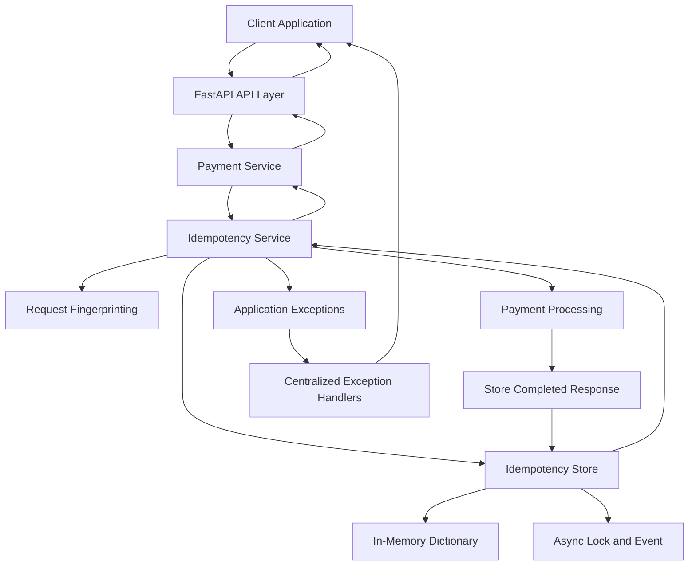
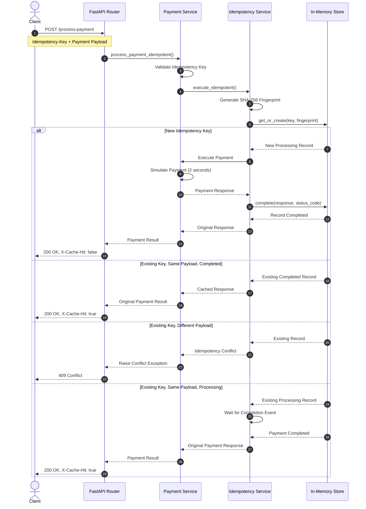
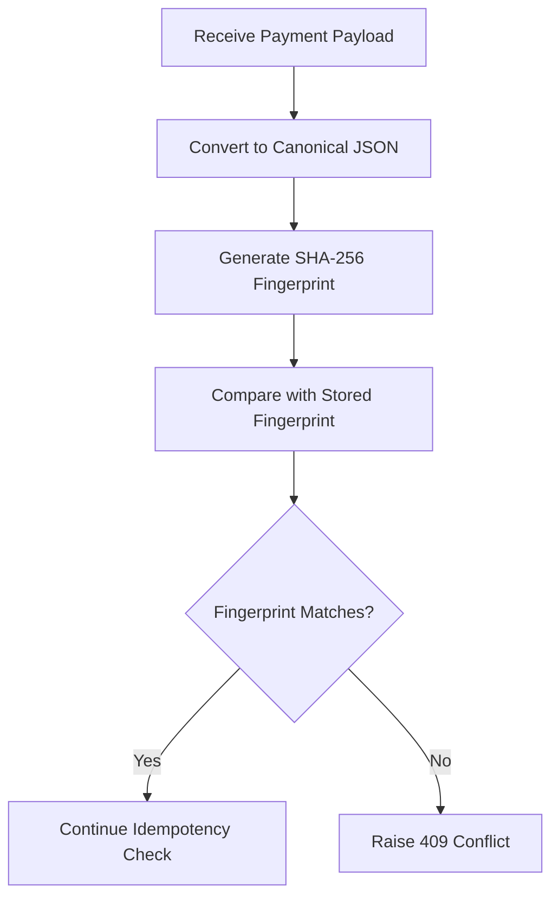
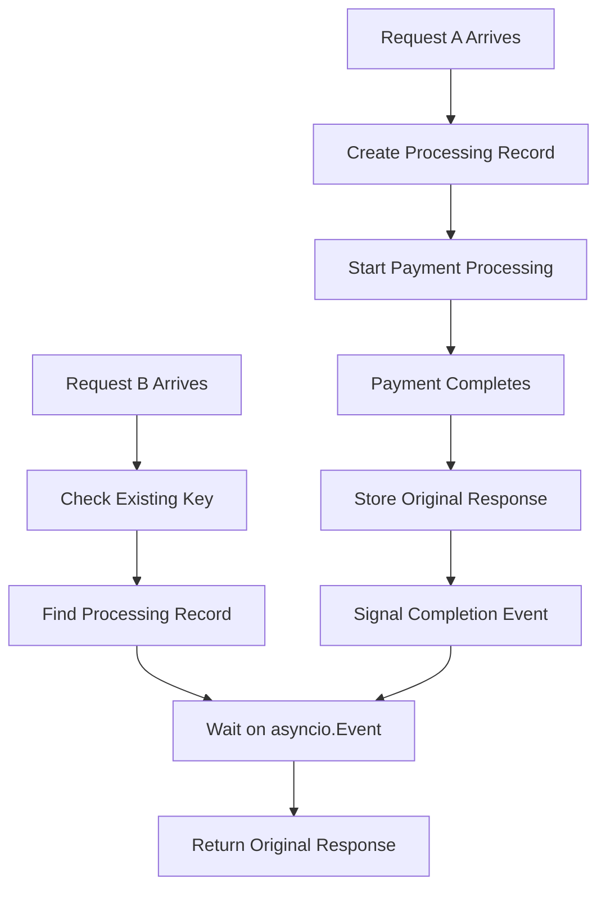
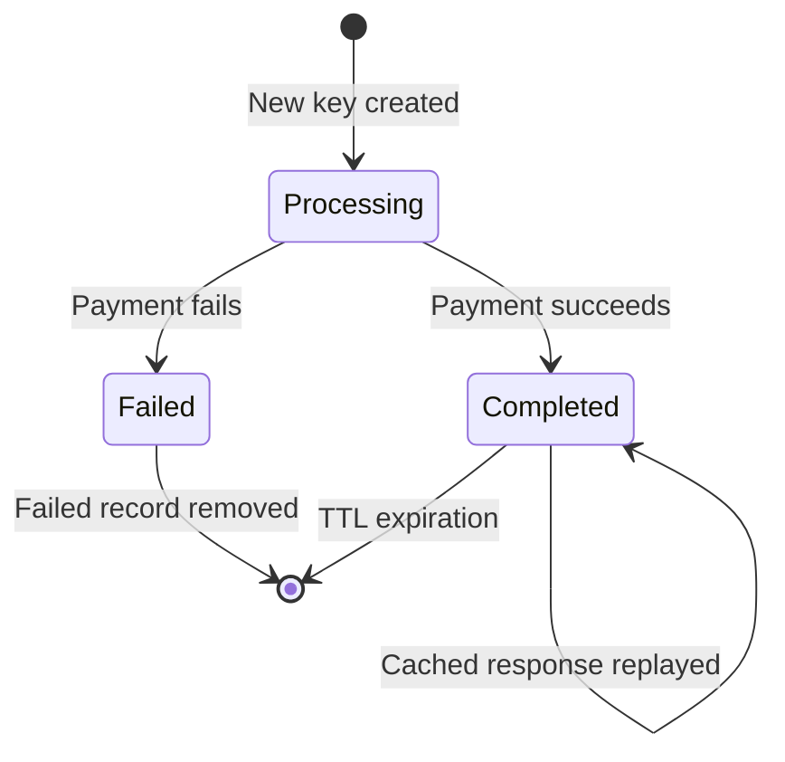

# FinSafe Idempotency Gateway – The "Pay-Once" Protocol

A concurrency-safe REST API that prevents duplicate payment processing through idempotency keys, request fingerprinting, and response caching.

---

## 1. Project Overview

FinSafe Idempotency Gateway is a backend service designed to prevent customers from being charged multiple times when payment requests are accidentally retried.

In payment systems, network timeouts can leave clients uncertain about whether a transaction was successful. A client may resend the same request, causing the payment processor to execute the transaction more than once.

This project implements an idempotency layer that ensures repeated requests with the same idempotency key and request payload do not trigger duplicate payment processing.

The gateway provides:

- Idempotency key validation.
- Request fingerprinting using SHA-256.
- Duplicate request detection.
- Cached response replay.
- Concurrent request coordination.
- Idempotency conflict detection.
- Automatic expiration of completed idempotency records.
- Centralized exception handling.

**Core principle:** The same idempotency key and the same request payload should produce the same payment result without executing the payment operation again.

---

## 2. Problem Statement

Imagine an online customer making a payment of 100 GHS.

1. The client sends a payment request.
2. The server starts processing the payment.
3. The network experiences a timeout.
4. The client assumes the request failed and retries.
5. Without idempotency protection, the server may process the payment again.

This can result in duplicate charges, financial losses, and reduced customer trust.

FinSafe needs a mechanism that recognizes repeated payment attempts and returns the original transaction result instead of processing the payment again.

### Proposed Solution

The gateway requires clients to provide a unique `Idempotency-Key` HTTP header.

The gateway stores a fingerprint of the request payload alongside the key.

When another request arrives:

- A new key starts payment processing.
- An existing key with the same payload returns the stored response.
- An existing key with a different payload is rejected.
- An identical request arriving while the original is processing waits for the original operation to finish.

---

## 3. Project Objectives

The main objectives are to:

1. Build a RESTful payment-processing API using FastAPI.
2. Prevent duplicate payment execution.
3. Detect when an idempotency key is reused with a different request payload.
4. Handle simultaneous requests without race conditions.
5. Return cached responses for completed requests.
6. Implement expiration for completed idempotency records.
7. Maintain a clean separation between API routes, business logic, storage, and exception handling.

---

## 4. Technology Stack

| Technology | Purpose |
|---|---|
| Python 3.10 | Backend programming language |
| FastAPI | REST API framework |
| Pydantic | Request validation and response schemas |
| asyncio | Asynchronous payment processing and concurrency coordination |
| SHA-256 | Request fingerprint generation |
| In-memory Dictionary | Idempotency record storage |
| asyncio.Lock | Atomic access to shared in-memory records |
| asyncio.Event | Coordination between simultaneous requests |
| pytest | Automated testing |
| pytest-asyncio | Asynchronous test execution |
| HTTPX | API endpoint testing |
| Uvicorn | ASGI application server |
| Vercel | Deployment platform |

---

## 5. System Architecture

The application follows a layered architecture. Each layer has a specific responsibility.

### Architecture Layers

**1. API Layer – `payment_routes.py`**

- Exposes the `/process-payment` endpoint.
- Accepts payment request data and the `Idempotency-Key` header.
- Delegates processing to the payment service.
- Returns the payment response and cache-hit header.

**2. Service Layer – `payment_service.py`**

- Validates the idempotency key.
- Prepares the payment payload.
- Defines the payment operation.
- Coordinates with the idempotency service.
- Formats the cache-hit header.

**3. Idempotency Layer – `idempotency_service.py`**

- Generates request fingerprints.
- Checks whether an idempotency key already exists.
- Detects conflicting request payloads.
- Coordinates concurrent requests.
- Returns cached responses.
- Stores successful payment results.

**4. Storage Layer – `idempotency_store.py`**

- Maintains idempotency records in memory.
- Provides synchronized record creation and access.
- Tracks processing and completed states.
- Manages expiration of completed records.

**5. Exception Layer – `exceptions.py` and `exception_handlers.py`**

- Defines application-specific exceptions.
- Converts application exceptions into consistent HTTP responses.
- Keeps HTTP error handling separate from business logic.

### High-Level Component Architecture



### System Interaction – Sequence Diagram

The following sequence diagram illustrates how the gateway processes a new payment request and handles a duplicate request.



---

## 6. Idempotency Mechanism

### 6.1 Idempotency Key

The client must include an `Idempotency-Key` in the HTTP request headers.

Example:

```http
POST /process-payment
Idempotency-Key: payment_12345
Content-Type: application/json
```

The key identifies a particular payment attempt.

The gateway validates that the key is present and is not empty or whitespace-only.

### 6.2 Request Fingerprinting

The gateway uses SHA-256 hashing to generate a fingerprint of the request payload.

Before generating the fingerprint, the payload is serialized into canonical JSON using:

- Sorted dictionary keys.
- Consistent JSON separators.
- UTF-8-compatible character handling.
- Rejection of non-standard JSON numeric values.

This ensures that logically equivalent JSON objects with different key orders produce the same fingerprint.

Example:

Request A:

```json
{
    "amount": 100,
    "currency": "GHS"
}
```

Request B:

```json
{
    "currency": "GHS",
    "amount": 100
}
```

Both requests produce the same fingerprint because their data is equivalent.

### 6.3 Why Fingerprinting Is Necessary

An idempotency key alone is insufficient.

For example:

- Request A uses key `payment_12345` with amount `100`.
- Request B uses the same key with amount `500`.

The gateway must not return the previous response or execute a different payment under the same key.

By comparing fingerprints, the gateway identifies whether the same key is being reused with a different request payload.

### Fingerprinting Flow



---

## 7. Concurrency Management

A major requirement of the gateway is to handle multiple identical requests arriving at approximately the same time.

Without proper synchronization, two requests could both check the store, find no existing record, and start processing the same payment.

This is a race condition.

The gateway addresses this using Python's asynchronous synchronization primitives.

### 7.1 asyncio.Lock

The in-memory store uses `asyncio.Lock` to synchronize access to shared records.

It protects the record creation and lookup operation so that simultaneous requests using the same key cannot independently create separate processing records.

### 7.2 asyncio.Event

Each processing record has an asynchronous event.

When a second identical request arrives while the first request is still processing:

1. The second request finds the existing processing record.
2. It waits on the record's event.
3. The first request completes payment processing.
4. The first request stores the response.
5. The completion event is signalled.
6. The waiting request resumes.
7. The second request receives the original response.

The waiting request does not start another payment operation.

### Concurrent Request Flow



### Concurrency Outcome

| Request | Behaviour |
|---|---|
| First request | Starts payment processing |
| Second identical request while processing | Waits for the first request |
| Second request after completion | Receives cached response |
| Same key with a different payload | Receives 409 Conflict |

---

## 8. Idempotency Record Management

Each idempotency record maintains information about a payment request.

### Record Fields

| Field | Description |
|---|---|
| `key` | Client-provided idempotency key |
| `fingerprint` | SHA-256 fingerprint of the request payload |
| `status` | Current processing state |
| `response_body` | Stored payment response |
| `status_code` | Original HTTP response status code |
| `event` | Async event used to coordinate waiting requests |
| `created_at` | Time the record was created |
| `completed_at` | Time the payment operation completed |

### Record States

The records move through the following states:

- `processing`: Payment processing has started.
- `completed`: Payment processing succeeded and the response has been stored.
- `failed`: Payment processing failed.

### Record Lifecycle



---

## 9. Response Caching and Replay

Once a payment has been successfully processed, the gateway stores its response and HTTP status code.

When an identical request is received again using the same key, the gateway returns the stored response.

The payment processing function is not executed again.

The gateway also includes an `X-Cache-Hit` response header.

### First Request

```http
POST /process-payment
Idempotency-Key: payment_12345
Content-Type: application/json
```

Request body:

```json
{
    "amount": 100,
    "currency": "GHS"
}
```

Example response:

```http
HTTP/1.1 200 OK
X-Cache-Hit: false
```

```json
{
    "message": "Charged 100 GHS",
    "amount": 100,
    "currency": "GHS",
    "transaction_id": "tx_1234567890",
    "status": "SUCCESS"
}
```

### Duplicate Request

The client sends the same request again with the same key and payload.

Example response:

```http
HTTP/1.1 200 OK
X-Cache-Hit: true
```

The response body and status code are replayed from the stored successful result.

The transaction ID remains the same because the original payment is not executed again.

---

## 10. Idempotency Key Expiration

### Developer's Choice: 24-Hour Time-to-Live (TTL)

An additional safety mechanism implemented in this project is the expiration of completed idempotency records.

Completed records are retained for 24 hours.

This provides a defined retry window while preventing completed records from remaining in memory indefinitely.

### How It Works

- The TTL is set to 86,400 seconds (24 hours).
- The expiration period starts when payment processing completes.
- Completed records are eligible for removal after the TTL expires.
- Processing records are not removed by completed-record expiration.
- Expiration is checked lazily when records are accessed.
- An explicit cleanup method is also available to remove expired records.

### Why This Feature Was Added

In a payment-processing system, idempotency records should not remain in storage forever.

Keeping completed records indefinitely can cause unnecessary memory consumption.

A 24-hour retention period provides a practical retry window while allowing expired records to be removed.

### Important Limitation

The current implementation uses in-memory storage. Expired records are removed through lazy expiration and the explicit cleanup method; there is no background cleanup scheduler.

---

## 11. Exception Handling

The application uses centralized exception handling to separate business logic from HTTP response formatting.

Custom application exceptions are defined in:

`app/core/exceptions.py`

HTTP exception handlers are defined in:

`app/core/exception_handlers.py`

The handlers are registered in:

`app/main.py`

### Custom Exceptions

| Exception | HTTP Status | Description |
|---|---:|---|
| `InvalidIdempotencyKeyException` | 400 | Missing or invalid idempotency key |
| `IdempotencyConflictException` | 409 | Same key used with a different request payload |

### Error Response Example

```json
{
    "detail": "Idempotency key already used for a different request body."
}
```

This approach keeps routes clean and allows the services to focus on business operations.

---

## 12. API Documentation

The application exposes a REST API endpoint for payment processing.

### Endpoint

| Method | Endpoint | Description |
|---|---|---|
| POST | `/process-payment` | Processes a payment with idempotency protection |

### Request Headers

| Header | Required | Description |
|---|---|---|
| `Idempotency-Key` | Yes | Unique identifier for a payment attempt |
| `Content-Type` | Yes | Must be `application/json` |

### Request Body

```json
{
    "amount": 100,
    "currency": "GHS"
}
```

### Successful Response

HTTP status: `200 OK`

```json
{
    "message": "Charged 100 GHS",
    "amount": 100,
    "currency": "GHS",
    "transaction_id": "tx_1234567890",
    "status": "SUCCESS"
}
```

### Response Headers

| Header | Meaning |
|---|---|
| `X-Cache-Hit: false` | New payment was processed |
| `X-Cache-Hit: true` | Previously completed response was replayed |

### HTTP Status Codes

| Status Code | Description |
|---:|---|
| 200 | Payment processed successfully or cached response returned |
| 400 | Missing or invalid idempotency key |
| 409 | Idempotency key reused with a different payload |
| 422 | Request body failed validation |

### Testing Through Swagger UI

FastAPI automatically generates interactive API documentation.

After starting the application, open:

```text
http://127.0.0.1:8000/docs
```

To test idempotency:

1. Open the `POST /process-payment` endpoint.
2. Click **Try it out**.
3. Enter the payment request body.
4. Provide an `Idempotency-Key`.
5. Execute the request.
6. Execute the same request again using the same key.
7. Compare the response bodies and `X-Cache-Hit` headers.

The first request should return `X-Cache-Hit: false`, while the duplicate should return `X-Cache-Hit: true`.

---

## 13. Project Structure

```text
Idempotency-gateway/
│
├── app/
│   ├── api/
│   │   ├── __init__.py
│   │   └── payment_routes.py
│   │
│   ├── core/
│   │   ├── __init__.py
│   │   ├── exceptions.py
│   │   └── exception_handlers.py
│   │
│   ├── schemas/
│   │   ├── __init__.py
│   │   └── payment.py
│   │
│   ├── services/
│   │   ├── __init__.py
│   │   ├── idempotency_service.py
│   │   └── payment_service.py
│   │
│   ├── storage/
│   │   └── idempotency_store.py
│   │
│   └── main.py
│
├── tests/
│   ├── __init__.py
│   ├── test_concurrancy.py
│   ├── test_idempotency.py
│   ├── test_idempotency_expiration.py
│   └── test_payment.py
│
├── .gitignore
├── .python-version
├── requirements.txt
└── README.md
```

---

## 14. Installation and Setup

### Prerequisites

Make sure you have:

- Python 3.10 or later.
- Git.
- pip.

### Step 1: Clone the Repository

```bash
git clone https://github.com/iirasubizadivine/finsafe-idempotency-gateway.git
```

### Step 2: Navigate to the Backend Project

```bash
cd finsafe-idempotency-gateway/backend/Idempotency-gateway
```

### Step 3: Create a Virtual Environment

```bash
python3.10 -m venv venv
```

### Step 4: Activate the Virtual Environment

Linux/macOS:

```bash
source venv/bin/activate
```

Windows:

```bash
venv\Scripts\activate
```

### Step 5: Install Dependencies

```bash
pip install -r requirements.txt
```

---

## 15. Running the Application

Start the FastAPI application using Uvicorn:

```bash
uvicorn app.main:app --reload
```

The API will be available at:

```text
http://127.0.0.1:8000
```

Interactive API documentation:

```text
http://127.0.0.1:8000/docs
```

Alternative API documentation:

```text
http://127.0.0.1:8000/redoc
```

---

## 16. Testing

The project uses pytest, pytest-asyncio, and HTTPX for automated testing.

Run the complete test suite:

```bash
python3.10 -m pytest -v
```

### Test Coverage Areas

| Test File | Purpose |
|---|---|
| `test_payment.py` | Payment processing and request validation |
| `test_idempotency.py` | Duplicate requests, response replay, and conflicting payloads |
| `test_concurrancy.py` | Simultaneous requests and concurrency behaviour |
| `test_idempotency_expiration.py` | Expiration and cleanup of idempotency records |

### Important Scenarios Tested

- Successful first payment request.
- Duplicate request with the same key and payload.
- Reuse of an idempotency key with a different payload.
- Missing idempotency key.
- Empty or whitespace-only idempotency key.
- Different keys processing separate payments.
- Equivalent JSON payloads with different key ordering.
- Simultaneous requests using the same key.
- Expiration of completed records.
- Protection of processing records during expiration cleanup.

---

## 17. Deployment

The application has been deployed using Vercel.

Deployment URL:

https://finset-dfkmdtwri-divine8.vercel.app

Interactive API documentation:

https://finset-dfkmdtwri-divine8.vercel.app/docs

The deployed API can be tested using the same endpoint and request format described in the API Documentation section.

---

## 18. Design Decisions and Trade-offs

### 18.1 In-Memory Storage

The project uses a native Python dictionary as its idempotency store.

This was selected because the challenge permits an in-memory storage solution and it keeps the implementation simple.

**Advantages:**

- Simple implementation.
- Fast access to records.
- No external database dependency.
- Suitable for demonstrating idempotency and asynchronous concurrency concepts.

**Limitations:**

- Records are lost when the application process restarts.
- Records are not shared across separate application processes or serverless instances.
- It is not suitable as-is for production payment infrastructure.

### 18.2 Asynchronous Processing

FastAPI and asyncio allow the application to handle waiting requests without blocking the entire event loop.

The payment operation is simulated using an asynchronous delay to demonstrate how the gateway handles requests while processing is in progress.

### 18.3 SHA-256 Fingerprinting

SHA-256 provides a consistent way to compare request payloads.

It prevents the gateway from treating two different payment requests as the same operation merely because they use the same idempotency key.

### 18.4 Centralized Exception Handling

Application exceptions are separated from HTTP response handling.

This makes the application easier to maintain and keeps HTTP-specific logic out of the service layer.

### 18.5 Response Replay

The gateway stores the original successful response and status code so that duplicate requests receive the same result without executing payment processing again.

### 18.6 Production Considerations

This implementation demonstrates idempotency within a single running application process. It does not provide distributed, cross-instance exactly-once payment execution.

A production payment gateway would require additional safeguards, such as:

- Durable shared storage.
- Atomic operations across multiple application instances.
- Database transactions and unique constraints.
- Distributed locking or equivalent coordination where appropriate.
- Integration with a real payment provider.
- Provider-side idempotency support.
- Recovery mechanisms for interrupted transactions.

The current implementation is an educational demonstration of the core idempotency protocol, not a production-ready financial transaction processor.

---

## 19. Future Improvements

Possible future improvements include:

1. Replace in-memory storage with Redis or a relational database.
2. Add persistent idempotency records that survive application restarts.
3. Introduce distributed concurrency control for multiple application instances.
4. Add structured logging and monitoring.
5. Integrate with a real payment provider.
6. Add transaction recovery and reconciliation mechanisms.
7. Implement configurable idempotency retention policies.

---

## 20. Conclusion

FinSafe Idempotency Gateway demonstrates how an idempotency layer can protect payment APIs against duplicate transaction attempts.

The project combines request fingerprinting, synchronized record creation, asynchronous concurrency coordination, response caching, and expiration to provide a structured approach to handling repeated payment requests.

It demonstrates practical backend engineering concepts, including API design, separation of concerns, asynchronous programming, concurrency control, exception handling, and automated testing.

**The goal is simple: one payment attempt should not result in multiple payment executions just because a client retries its request.**

---

## License

This project is licensed under the MIT License.

See the [LICENSE](LICENSE) file for details.