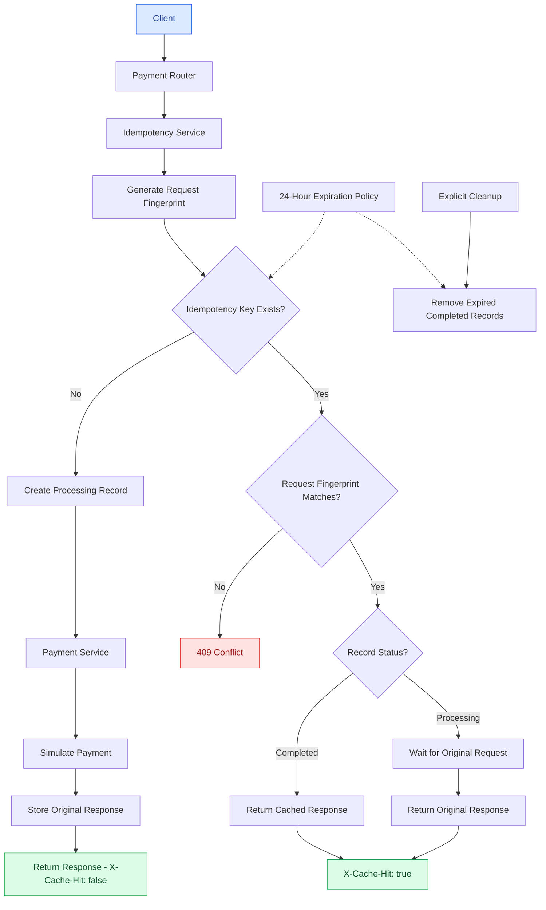

# FinSafe Idempotency Gateway – Pay-Once Protocol

A payment API built with **Python and FastAPI** that prevents duplicate payment processing using idempotency keys.

The system ensures that when a client retries a payment request because of a timeout, network failure, or lost response, the same payment is not processed more than once.

---

## 1. Problem Statement

In payment systems, clients sometimes retry requests when they do not receive a response from the server.

Without proper protection, these retries can result in duplicate charges.

For example:

1. A client sends a payment request.
2. The server successfully processes the payment.
3. The response is lost because of a network failure.
4. The client retries the same request.
5. Without idempotency protection, the customer may be charged twice.

The FinSafe Idempotency Gateway solves this problem by ensuring that identical requests using the same idempotency key are processed only once.

---

## 2. Solution Overview

The gateway uses an `Idempotency-Key` HTTP header to identify unique payment operations.

When a request is received:

- If the key is new, the payment is processed and its response is stored.
- If the same key and same request body are received again, the original response is returned.
- If the same key is reused with a different request body, the API returns a conflict error.
- If identical requests arrive concurrently, only one payment is processed while the others wait for the original result.

The system also implements a 24-hour idempotency key retention policy.

---

## 3. Technologies Used

| Technology | Purpose |
|---|---|
| Python 3.10 | Programming language |
| FastAPI | REST API framework |
| Pydantic | Request validation and data schemas |
| Uvicorn | ASGI application server |
| asyncio | Asynchronous processing and concurrency |
| pytest | Automated testing |
| HTTPX | API testing |

---

## 4. Architecture

The application follows a layered architecture where each component has a specific responsibility.



### Component Responsibilities

| Component | Responsibility |
|---|---|
| Payment Router | Receives and validates payment requests |
| Idempotency Service | Coordinates idempotency and duplicate detection |
| Fingerprint Generator | Creates SHA-256 request fingerprints |
| Idempotency Store | Stores keys, fingerprints, statuses and responses |
| Payment Service | Simulates payment processing |
| Expiration Policy | Enforces the 24-hour retention period |

### Main Components

**Payment Router**

- Receives payment requests.
- Validates the Idempotency-Key header.
- Calls the idempotency service.
- Returns the payment response and cache status.

**Idempotency Service**

- Generates request fingerprints.
- Determines whether a request is new, duplicated, or conflicting.
- Coordinates concurrent requests.
- Returns cached responses when appropriate.

**Idempotency Store**

- Stores idempotency records.
- Tracks request fingerprints and processing status.
- Stores original response bodies and status codes.
- Enforces key expiration.

**Payment Service**

- Simulates payment processing.
- Generates transaction IDs.
- Returns payment confirmation details.

---

## 5. Project Structure

```text
Idempotency-gateway/
│
├── app/
│   ├── api/
│   │   └── payment_routes.py
│   │
│   ├── core/
│   │   └── exceptions.py
│   │
│   ├── schemas/
│   │   └── payment.py
│   │
│   ├── services/
│   │   ├── payment_service.py
│   │   └── idempotency_service.py
│   │
│   ├── storage/
│   │   └── idempotency_store.py
│   │
│   └── main.py
│
├── tests/
│   ├── test_payment.py
│   ├── test_idempotency.py
│   ├── test_concurrancy.py
│   └── test_idempotency_expiration.py
│
├── README.md
└── requirements.txt
```

---

## 6. Installation and Setup

### Prerequisites

- Python 3.10 or higher
- Git
- pip

### Clone the repository

```bash
git clone YOUR_GITHUB_REPOSITORY_URL
```

Navigate into the project:

```bash
cd Idempotency-gateway
```

### Create a virtual environment

```bash
python3.10 -m venv venv
```

Activate it on Linux or macOS:

```bash
source venv/bin/activate
```

### Install dependencies

```bash
pip install -r requirements.txt
```

---

## 7. Running the Application

Start the FastAPI server from the project root:

```bash
python3.10 -m uvicorn app.main:app --reload
```

The API will be available at:

```text
http://127.0.0.1:8000
```

Interactive API documentation:

```text
http://127.0.0.1:8000/docs
```

---

## 8. API Documentation

### Process Payment

**Endpoint**

```http
POST /process-payment
```

**Required Header**

```http
Idempotency-Key: unique-payment-key-123
```

**Request Body**

```json
{
    "amount": 100,
    "currency": "RWF"
}
```

### Successful Response

**Status Code:** `200 OK`

```json
{
    "message": "Charged 100 RWF",
    "amount": 100,
    "currency": "RWF",
    "transaction_id": "tx_1234567890",
    "status": "SUCCESS"
}
```

The transaction ID is generated by the payment service.

---

## 9. Idempotency Behavior

### Scenario 1: First Request

A client sends a payment request with a new idempotency key.

```http
Idempotency-Key: payment-001
```

The payment is processed.

Response header:

```http
X-Cache-Hit: false
```

Response status:

```http
200 OK
```

### Scenario 2: Duplicate Request

The client retries the same request using the same key and identical request body.

The gateway does not process the payment again.

Instead, it returns the original stored response.

Response header:

```http
X-Cache-Hit: true
```

The original transaction ID and response body are preserved.

### Scenario 3: Same Key, Different Request Body

A client sends:

```json
{
    "amount": 100,
    "currency": "RWF"
}
```

Then reuses the same key with:

```json
{
    "amount": 500,
    "currency": "RWF"
}
```

The gateway rejects the request.

**Status Code:** `409 Conflict`

Response:

```json
{
    "detail": "Idempotency key already used for a different request body."
}
```

### Scenario 4: Different Idempotency Keys

Two requests with different idempotency keys are treated as separate payment operations, even when their request bodies are identical.

---

## 10. Concurrency Handling

The gateway supports concurrent requests using the same idempotency key.

When multiple identical requests arrive at approximately the same time:

1. The first request creates an idempotency record with a processing status.
2. The first request begins payment processing.
3. Subsequent requests find the existing processing record.
4. They wait for the first request to complete.
5. Once processing finishes, they receive the original response.

This prevents multiple payment executions for the same key within the application process.

The implementation uses:

- `asyncio.Lock` to protect access to the in-memory store.
- `asyncio.Event` to notify waiting requests when processing completes.

---

## 11. Additional Feature: 24-Hour Idempotency Key Expiration

The gateway implements a 24-hour retention policy for completed idempotency records.

After a successful payment, the completed record is retained for 24 hours.

During this period:

- Repeated requests with the same key and payload return the original response.
- Reusing the same key with a different payload returns a conflict.

After 24 hours:

- The completed record is considered expired.
- The key can be reused for a new payment.
- A new payment operation can be processed.

Expiration is calculated from the payment completion time rather than the request creation time.

The store supports explicit cleanup through `cleanup_expired()` and removes an expired record when its key is reused.

---

## 12. Error Handling and Validation

The API validates payment requests before processing them.

| Condition | HTTP Status |
|---|---|
| Successful payment | 200 OK |
| Missing Idempotency-Key | 400 Bad Request |
| Empty Idempotency-Key | 400 Bad Request |
| Same key with different payload | 409 Conflict |
| Invalid amount | 422 Unprocessable Entity |
| Invalid currency format | 422 Unprocessable Entity |

Validation includes:

- Amount must be greater than zero.
- Currency must contain exactly three letters.
- Currency is normalized to uppercase.
- Idempotency-Key must be present and non-empty.

---

## 13. Running Tests

The project uses pytest and HTTPX for automated testing.

Run all tests:

```bash
python3.10 -m pytest -v
```

Run only payment tests:

```bash
python3.10 -m pytest tests/test_payment.py -v
```

Run idempotency tests:

```bash
python3.10 -m pytest tests/test_idempotency.py -v
```

Run concurrency tests:

```bash
python3.10 -m pytest tests/test_concurrancy.py -v
```

Run expiration tests:

```bash
python3.10 -m pytest tests/test_idempotency_expiration.py -v
```

### Test Coverage

The automated tests verify:

- Successful payment processing.
- Missing and empty idempotency keys.
- Payment validation.
- Duplicate request handling.
- Cached response replay.
- Conflicting payload detection.
- Different JSON key ordering.
- Independent payments using different keys.
- Concurrent request handling.
- 24-hour expiration behavior.
- Protection of in-progress records during cleanup.

**Latest test result: 14 tests passed.**

---

## 14. Design Decisions

### Request Fingerprinting

The gateway generates a SHA-256 fingerprint from the payment request body.

JSON keys are sorted before hashing to ensure that different JSON key ordering does not produce different fingerprints.

Decimal values are normalized to avoid treating equivalent monetary values such as `100`, `100.0`, and `100.00` as different requests.

### In-Memory Storage

The current implementation uses an in-memory dictionary protected by an asynchronous lock.

This keeps the implementation simple and demonstrates idempotency behavior without requiring an external database.

However, records are lost when the application restarts, and the store is not shared across multiple application workers.

A production implementation would use persistent shared storage such as Redis or PostgreSQL.

### Concurrency

Asynchronous locks and events coordinate requests sharing the same key, preventing duplicate processing within a single application process.

### Response Replay

The gateway stores the original response body and HTTP status code.

Duplicate requests receive the stored response instead of triggering another payment operation.

---

## 15. Limitations and Future Improvements

The current implementation is designed as an educational prototype.

Potential production improvements include:

- Persistent storage using Redis or PostgreSQL.
- Distributed locking for multiple application workers.
- Automatic background cleanup of expired records.
- Integration with a real payment provider.
- Authentication and authorization.
- Improved monitoring and observability.
- Recovery mechanisms for interrupted payment processing.

---

## 16. Conclusion

FinSafe Idempotency Gateway demonstrates how idempotency can protect payment APIs from duplicate processing caused by client retries and concurrent requests.

By combining request fingerprinting, response caching, concurrency coordination, and a 24-hour retention policy, the gateway provides a foundation for safer and more reliable payment processing.

---

**Project:** FinSafe Idempotency Gateway – Pay-Once Protocol  
**Backend:** Python / FastAPI  
**Testing:** pytest / HTTPX
